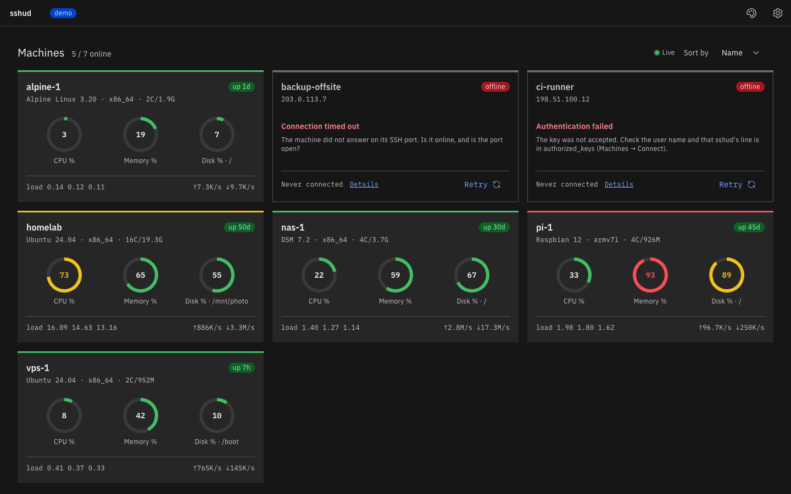
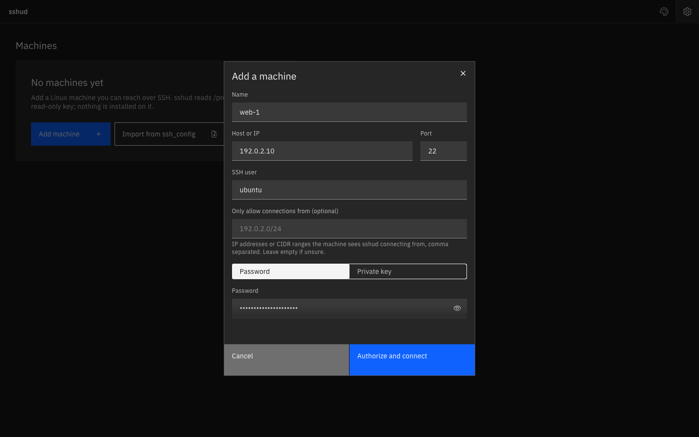
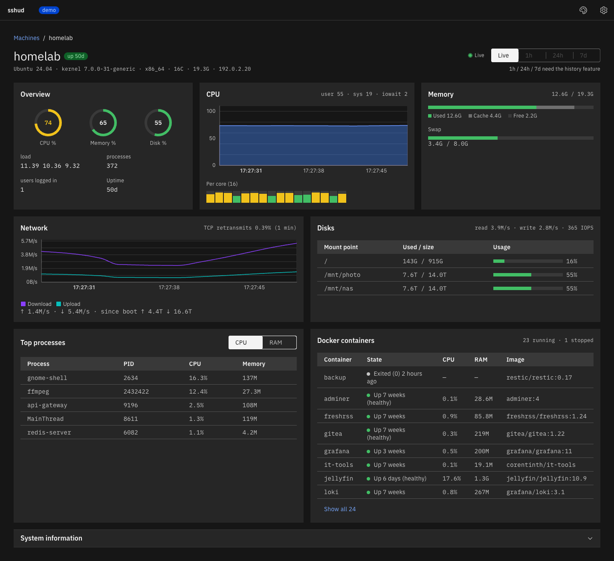
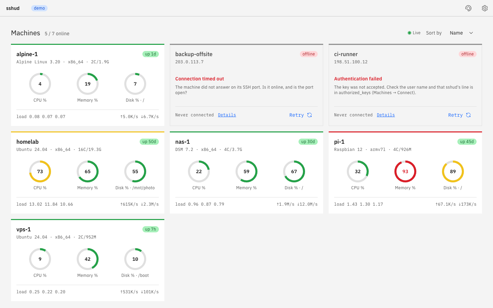
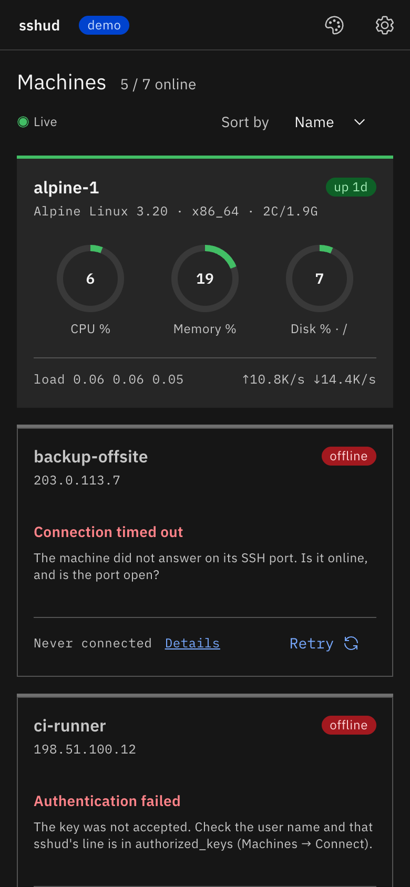
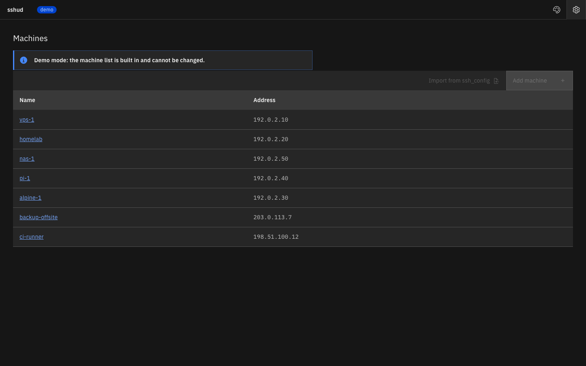

# sshud

A web dashboard for your Linux machines that **installs nothing on them**.
sshud reads `/proc` over SSH when someone is looking, and shows CPU,
memory, disk, network, processes and containers for every machine on one
screen, in IBM Carbon's dark theme.

No agent, no daemon, no open port on the monitored machines: only an SSH key
that can do nothing but read.



## Why

- **Zero install.** Monitored machines only need `sshd` and `/proc`. Works on
  Ubuntu, Debian, Raspberry Pi OS, Alpine/BusyBox and Synology DSM.
- **Nothing runs when nobody looks.** Machines are probed only while a page is
  open: every 5 s on the overview, every 2 s on a detail page. Idle SSH
  connections close after 5 minutes. A probe costs the machine about 25 ms of CPU.
- **Numbers you can check.** Memory "used" is what `free` calls used, disks
  match `df`, CPU is measured inside one probe so the first frame already has
  numbers. Each figure is computed on the server from raw `/proc` text, and
  the parsers are tested against captured output from real systems.
- **A key that can only read.** sshud uses its own key, locked in
  `authorized_keys` to a fixed read-only command. Adding a machine takes one
  form: address, user and a password or key, done. Your password or key is
  used only at that moment and never stored.

## Quick start

sshud is one static binary for Linux (amd64, arm64, armv7) with the UI built
in, or a container image for the same platforms. Pick one:

### 1. Binary from GitHub Releases

Download `sshud_<version>_linux_<arch>.tar.gz` from
[Releases](https://github.com/vinci7/sshud/releases) and check it against
`checksums.txt`:

```sh
tar -xzf sshud_*_linux_amd64.tar.gz
./sshud --demo                 # sample machines, no SSH needed: http://127.0.0.1:8080
./sshud --data ./data          # your own machines
```

### 2. `docker run`

```sh
docker run -d --name sshud \
  -p 127.0.0.1:8080:8080 \
  -e SSHUD_PASSWORD='choose-a-long-password' \
  -v sshud-data:/data \
  ghcr.io/vinci7/sshud:latest
```

### 3. Docker Compose

```yaml
services:
  sshud:
    image: ghcr.io/vinci7/sshud:latest
    restart: unless-stopped
    ports:
      - "127.0.0.1:8080:8080"
    environment:
      SSHUD_PASSWORD: choose-a-long-password
      # Host names you open sshud under, comma-separated, when that is not
      # localhost or an IP address (for example behind a reverse proxy):
      # SSHUD_HOSTS: sshud.example.net
    volumes:
      - sshud-data:/data   # database and sshud's own SSH key
volumes:
  sshud-data:
```

- Publish on `127.0.0.1` unless you put a reverse proxy in front: whoever
  opens the page first can otherwise set the password. Setting
  `SSHUD_PASSWORD` closes that gap.
- sshud's key is created inside the `/data` volume; there is no key to
  mount.
- Add `--demo` to the binary or to the end of the `docker run` command to
  see built-in sample machines (replayed from sanitized captures) without
  SSH access to anything.

### Add your machines

1. Open the page and create the admin password (unless `SSHUD_PASSWORD`
   already set it).
2. Click the gear icon, then **Add machine** (or **Import from ssh_config** and
   paste your `~/.ssh/config`).
3. Fill in host and user, and type the account's password (or paste a
   private key) once in the same form. sshud installs its
   `authorized_keys` line and connects. Imported machines, or anyone who
   would rather not type a password, use **Connect** to get the line and a
   command to run on their own computer.



That is all. No package to install on the other side.

### Build from source

You need **Go 1.24+** and **Node.js 20.19+** (or 22.12+):

```sh
git clone https://github.com/vinci7/sshud && cd sshud
make check                 # builds the UI and the binary, runs the tests
./bin/sshud --demo
```

`docker build -t sshud .` builds the image locally.

### Behind a reverse proxy or a host name

sshud only answers requests addressed to `localhost`, `*.localhost` or an
IP address. If you open it under a name, such as `https://sshud.example.net`
through a reverse proxy or a local DNS entry, list that name:

```sh
SSHUD_HOSTS=sshud.example.net ./bin/sshud    # or --hosts, comma-separated
```

Other names get `421 Misdirected Request`. This blocks DNS rebinding: a web
page you visit could otherwise point its own domain at sshud's address and
read your dashboard from your browser, since to the browser that is still
the page's own site.

## Security model

sshud has exactly one way to connect. On first use it creates a dedicated
ed25519 key (`data/strict_ed25519`, mode 600). Each monitored machine has
one line in `~/.ssh/authorized_keys` of the account you entered:

```
restrict,command="sh -c '…probe…'",from="192.0.2.0/24" ssh-ed25519 AAAA… sshud
```

- `command=` forces sshd to run the probe whatever the client asks for, so a
  stolen key can only print the probe output: no shell, no file access.
- `restrict` turns off port, agent and X11 forwarding, PTYs and `~/.ssh/rc`.
- `from=` (optional) only accepts the key from the given addresses.

**Adding a machine installs the line for you**, with credentials used once:

1. You enter the address, port and user, and the account's password (or
   paste a private key and its passphrase), in one form.
2. sshud trusts the host key on first use, like
   `ssh -o StrictHostKeyChecking=accept-new`: it accepts the key a new
   machine presents and records it. From then on a different key is refused
   before any credential is sent, until you re-trust it in the UI.
3. sshud logs in once (password, then keyboard-interactive), backs up
   `authorized_keys` to `authorized_keys.bak-<time>`, installs the line,
   reconnects with its own key to check that it works, and records the
   host key.

Your password or key is used only in that one request and never stored:
not in the database, not on disk, not in logs or error messages. If sshd
reads keys from somewhere unusual (`AuthorizedKeysFile`) or ignores options
in `authorized_keys`, the check in step 3 fails and says so.

The trade-off: the fingerprint is not checked when you first add a machine.
If someone intercepts that very first connection, a password typed for it
can leak. A private key cannot: the key never leaves sshud, only a signature
over this one connection is sent. Use a key, or install manually, if that
first connection crosses a network you do not trust.

**Rather not hand over credentials?** "Authorize manually" shows the line and
a command to run on **your own computer**, both with a copy button:

```sh
ssh -p 22 -- ubuntu@192.0.2.10 'mkdir -p ~/.ssh && chmod 700 ~/.ssh && … ~/.ssh/authorized_keys …'
```

It runs the same install script with your own SSH key, so sshud never sees
it. Both ways replace an older sshud line for the same key (sshd uses the
first matching line, so a plain append could never update it). You can also
paste the line by hand. **Machines → Connect** shows both again at any time.

The probe is about 1.8 KB of POSIX shell in
[`internal/probe/probe.sh`](internal/probe/probe.sh). It only reads: files
under `/proc` and `/sys/class/thermal`, `/etc/os-release` (or Synology's
`/etc.defaults/VERSION`), Ubuntu's pending-update summary, whether
`/var/run/reboot-required` exists, and the output of `df`, `uname`, `getconf`,
`who`, `ip addr` and, if present, `docker ps`. Use an unprivileged account.

The line starts by printing the probe's version. When a new sshud
version changes the probe, machines with an older line keep working (metrics
the old probe does not collect stay empty) and the overview lists them;
install the new line from **Machines → Connect**.

`from=` is optional. Put the address the monitored machine sees sshud
connecting from: its LAN address, its VPN address, or for Docker the host's
address (containers usually leave through the host's IP). If unsure, leave it
empty and check `/var/log/auth.log` on the machine after a test connection.

The container list needs the account to be in the `docker` group, and **that
group is root-equivalent**. The key itself can still only run the probe, but the account can do more if someone logs into it another way.
Skip the group if you do not need the container list.

## What you see

- **Overview:** one tile per machine with CPU, memory and fullest-disk rings.
  Colours mean state only: green, yellow from 70 % (disk 80 %), red from 90 %.
  Load, network rates and uptime underneath. Unreachable machines say why
  (timeout, refused, authentication, changed host key…) and when they were
  last seen.
- **Theme and language:** light or dark (following the system by default), English or Simplified Chinese, from the palette icon.
- **Detail page:** live CPU chart with user/system/iowait and every core,
  memory and swap, network with TCP retransmits, disks with I/O rates, top
  processes, Docker containers, and system information (kernel, addresses,
  pending updates, reboot required, temperatures).



| Light theme | Phone |
|---|---|
|  |  |



Charts start when you open the page. There is no stored history yet, which is
why the 1h / 24h / 7d buttons are disabled.

## How sshud compares

| | On each monitored machine | Web UI | Where credentials live | What it shows |
|---|---|---|---|---|
| **sshud** | Nothing (SSH only) | Yes, self-hosted | One restricted key on the sshud server | Live metrics, processes, containers |
| [Beszel](https://github.com/henrygd/beszel), [Netdata](https://github.com/netdata/netdata), [Glances](https://github.com/nicolargo/glances), [Nezha](https://github.com/nezhahq/nezha) | An agent | Yes | Agent tokens or keys | Metrics with history; most also alert |
| [Uptime Kuma](https://github.com/louislam/uptime-kuma) | Nothing | Yes | Per check, if any | Whether services are up, with history and alerts |

sshud fits when you want zero-install, browser-based monitoring for a
handful of machines you own. If you need history, alerts or many users, an
agent-based tool will serve you better, and Uptime Kuma pairs well with any
of them for availability checks.

## Limitations / non-goals

- **Linux only.** The probe reads `/proc`; BSD, macOS and Windows are not
  supported.
- **No history.** Only the last 5 minutes are kept, in memory, for the
  charts; nothing is written to disk.
- **No alerts.** sshud is a screen to look at, not a pager.
- **One admin.** A single password, no users or roles.
- **On demand only.** Machines are probed only while someone has the page
  open; when nobody is looking, nothing is collected.

## Compatibility notes

- **Synology DSM:** enable *User home service* so the account has a home for
  `~/.ssh/authorized_keys`; sshd ignores the file when the home or `.ssh`
  directory is writable by others (use `chmod 755 ~` and `chmod 700 ~/.ssh`).
  `docker ps` needs root on DSM, so the container list stays empty.
- **Alpine / BusyBox:** works with BusyBox `sh`, `df` and `ip`; logged-in
  users and pending updates are not available.

## Configuration

| Flag | Environment | Default | |
|---|---|---|---|
| `--listen` | | `127.0.0.1:8080` | HTTP address |
| `--data` | `SSHUD_DATA` | `data` | database and sshud's SSH key |
| `--hosts` | `SSHUD_HOSTS` | | host names sshud is reached by, comma-separated; `localhost` and IP addresses always work ([why](#behind-a-reverse-proxy-or-a-host-name)) |
| `--auth` | `SSHUD_AUTH` | `password` | `none` turns login off, for use behind an authenticating reverse proxy |
| | `SSHUD_PASSWORD` | | sets the admin password at start |
| `--demo` | | off | sample machines, no SSH |
| | `SSHUD_DEMO_MACHINES` | 7 | number of demo machines, to try a large dashboard |

Machines can also be managed from the command line:

```sh
sshud machine add --name web-1 --host 192.0.2.10 --user ubuntu
sshud machine list
sshud machine rm web-1
```

## Security notes

- sshud's private key stays in the data directory (mode 600). It is never
  stored in the database, returned by the API or written to logs.
- The password or key you give when adding a machine is used for that one
  request and dropped.
- Host keys are trusted on first use (like `accept-new`) and pinned; a
  changed key stops the connection before any credential is sent, and the
  machine shows "host key changed" until you re-trust it. The first
  connection is not verified, so a password given then can leak to an
  attacker in the middle; a private key cannot.
- One admin password (bcrypt). Sessions are signed cookies (HttpOnly,
  SameSite=Strict, Secure behind HTTPS) and changing the password ends all of
  them.
- When no password is set, **the first visitor creates it**. If you expose
  sshud to a network you do not trust, set `SSHUD_PASSWORD` before the
  first start, or keep it behind a VPN or authenticating proxy.

## How it works

```
browser ──SSE──▶ api ─▶ hub (probes on demand) ─▶ sshpool (one connection per machine) ─▶ machine
                          └─ parse (pure functions) → derive (rates from two frames)
store: SQLite (machines, host keys, settings)
```

A single Go binary (no CGO) with the React/Carbon UI embedded. The machine
only ever returns raw text; all parsing happens in sshud, so supporting a
new system means adding a sample to [`samples/`](samples) and a test.

## Development

Requirements: Go 1.24+, Node.js 20.19+ (or 22.12+).

```sh
make check                    # build UI, go vet, go test, build binary
cd web && npm run dev         # UI with hot reload, proxies /api to :8080
```

## License

[Apache-2.0](LICENSE)
